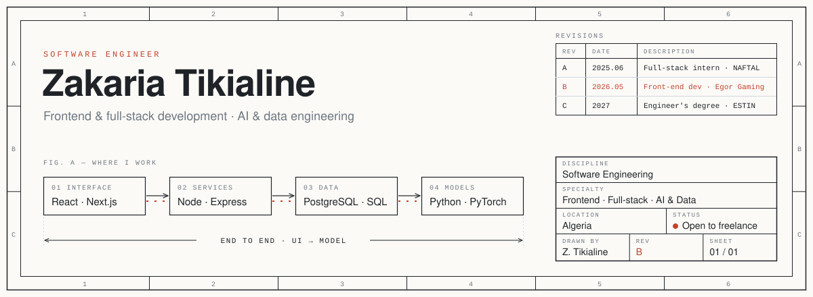

<!-- Profile README · Zakaria Tikialine · rev. B · 2026.10 -->

<picture>
  <source media="(prefers-color-scheme: dark)" srcset="./assets/sheet-dark.svg">
  <source media="(prefers-color-scheme: light)" srcset="./assets/sheet-light.svg">
  
</picture>

  <a href="https://www.zakaria-tikialine.tech/en"><b>Portfolio</b></a>&nbsp;&nbsp;·&nbsp;&nbsp;
  <a href="https://www.linkedin.com/in/zakaria-tikialine-68857025b/"><b>LinkedIn</b></a>&nbsp;&nbsp;·&nbsp;&nbsp;
  <a href="mailto:zakariatikia@gmail.com"><b>Email</b></a>

 

### 01 &nbsp;Profile

I'm a software engineer in the final year of an engineering degree in AI & Data at ESTIN, and a front-end developer on a live gaming platform. Most of my work so far has been shipping web products end to end: the interface, the API behind it, and the database under that.

The layer I'm building toward is the one after: data pipelines and machine learning systems that end up in front of real users, not in a notebook.

 

### 02 &nbsp;Selected work

**Tahwisa** &nbsp;NAFTAL · 2025 · Next.js, Express, PostgreSQL, TypeScript

<table>
  <tr>
    <td width="130" valign="top">CONTEXT</td>
    <td>NAFTAL needed one platform for employee registration and travel management across its centers.</td>
  </tr>
  <tr>
    <td valign="top">CONTRIBUTION</td>
    <td>Built the full system: REST API with role-based access control, a normalized PostgreSQL schema with tuned queries, automated participant selection, and the Next.js interface.</td>
  </tr>
  <tr>
    <td valign="top">OUTCOME</td>
    <td>Deployed to production and used by NAFTAL staff. Source is private.</td>
  </tr>
</table>

**Frontend architecture migration** &nbsp;Egor Gaming · 2026 · Next.js, TypeScript

<table>
  <tr>
    <td width="130" valign="top">CONTEXT</td>
    <td>A live competitive gaming platform (tournaments, messaging, player accounts) whose codebase had grown as one flat components folder.</td>
  </tr>
  <tr>
    <td valign="top">CONTRIBUTION</td>
    <td>Led the move to a feature-based architecture, one product domain at a time across 17 domains. Ran a platform-wide bug audit and wrote the API contract gap report for the backend team.</td>
  </tr>
</table>

 

### 03 &nbsp;Experience

| Period | Role | Organisation |
| :-- | :-- | :-- |
| May 2026 – present | Front-End Developer | Egor Gaming |
| Jun – Jul 2025 | Full-Stack Developer, intern | NAFTAL · DCSI |
| 2022 – 2027 | Engineering degree, AI & Data | ESTIN, Béjaïa |

Certified **Associate Data Scientist**, DataCamp.

 

### 04 &nbsp;Working together

I take on freelance projects alongside my role, mostly:

- **Web applications and internal tools** — registration systems, admin panels, dashboards
- **E-commerce and product sites** — custom built, fast, and yours to own
- **Data work** — database design, reporting, and wiring data into an existing product

How a project runs: a short call and a written scope with a fixed quote, then weekly progress on a live preview link, then deployment and a handover with the full source code.

 

### 05 &nbsp;Toolkit

| Layer | Primary | Also used |
| :-- | :-- | :-- |
| Interface | TypeScript, React, Next.js, Tailwind CSS | Redux |
| Services | Node.js, Express, REST, WebSockets | Go |
| Data | PostgreSQL, SQL | MongoDB, Redis, MySQL, Oracle |
| ML & analysis | Python, Pandas, NumPy, scikit-learn | PyTorch, TensorFlow, OpenCV |
| Delivery | Git, Docker, Linux, Vercel, Railway | |

 

### 06 &nbsp;Activity

<picture>
  <source media="(prefers-color-scheme: dark)" srcset="https://raw.githubusercontent.com/ZakariaTikialine/ZakariaTikialine/output/snake-dark.svg">
  <source media="(prefers-color-scheme: light)" srcset="https://raw.githubusercontent.com/ZakariaTikialine/ZakariaTikialine/output/snake.svg">
  
</picture>

Fig. B — Contribution graph, redrawn daily.

  

---

  Hiring, or have a project in mind? Write to <a href="mailto:zakariatikia@gmail.com">zakariatikia@gmail.com</a> with what you're building and when you need it.
    
  Sheet 01 of 01 · Rev. B · October 2026

